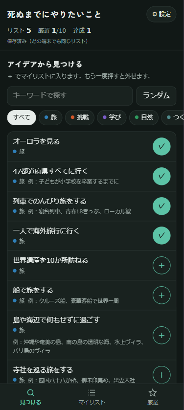

# 死ぬまでにやりたいことリスト

たくさんのアイデアから、死ぬまでにやりたいことを選んで、自分のリストを作るアプリです。

本番：https://yaritai.over40web.club



- 287件のアイデア集から選んでマイリストに入れる。自分で書いてもよい
- 「死ぬまでに絶対やる」を厳選して、達成を記録する
- 公開リンク（推測しづらい URL）で、リストをログインしていない人にも見せる

用語は [CONTEXT.md](CONTEXT.md)、設計の判断は [docs/adr/](docs/adr/) にまとめています。

## 構成

- TanStack Start（React）＋ Cloudflare Workers（Cloudflare Vite プラグイン）
- Cloudflare D1 ＋ Drizzle ORM
- better-auth（Google ログイン）
- Tailwind CSS

## ローカルで動かす

```sh
npm install
cp .dev.vars.example .dev.vars   # 値を入れる（Google OAuth のクライアント ID など）
npm run db:migrate               # ローカルの D1 にマイグレーションを当てる
npm run dev                      # http://localhost:3000
```

Google OAuth のリダイレクト先は `http://localhost:3000/api/auth/callback/google` にしてください。そのため、ポートは 3000 に固定しています。
開発中の D1 はローカル（Miniflare）で動きます。本番の D1 には触れません。

## コマンド

| コマンド | 内容 |
|---|---|
| `npm run dev` | 開発サーバー |
| `npm run typecheck` | 型チェック |
| `npm test` | テスト（vitest） |
| `npm run db:generate` | `src/db/schema.ts` からマイグレーション SQL を作る |
| `npm run db:migrate` | ローカルの D1 にマイグレーションを当てる |
| `npm run db:migrate:prod` | 本番の D1 にマイグレーションを当てる |
| `npm run deploy` | ビルドして本番にデプロイ |

## 本番に出す

スキーマを変えたときは、**デプロイより先に** `npm run db:migrate:prod` を実行してください。先にデプロイすると、新しいコードが存在しない列を読み書きしてエラーになります。

```sh
npm run db:migrate:prod   # スキーマを変えたときだけ
npm run deploy
```

本番の秘密の値（`BETTER_AUTH_SECRET`、`GOOGLE_CLIENT_ID`、`GOOGLE_CLIENT_SECRET`）は `wrangler secret put` で設定します。
